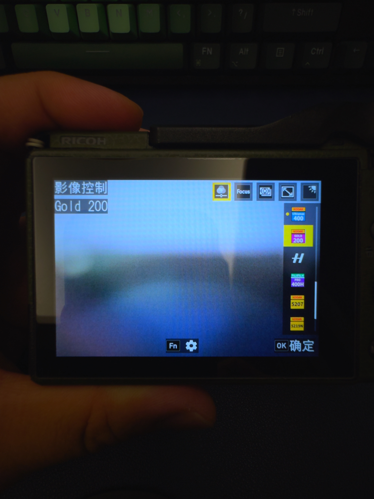
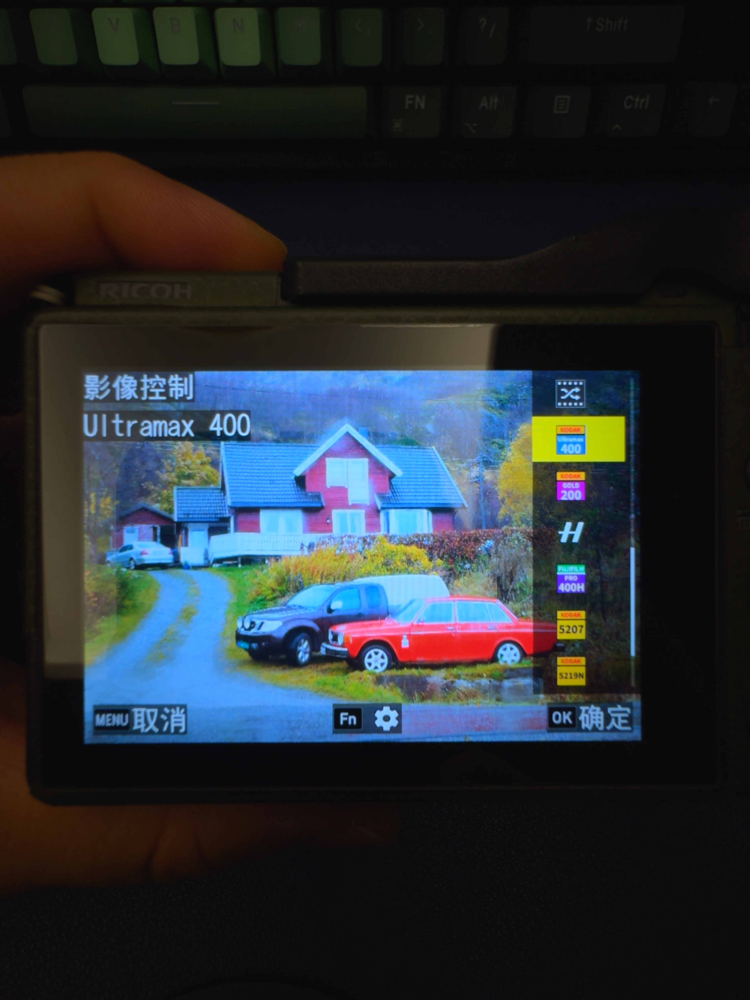
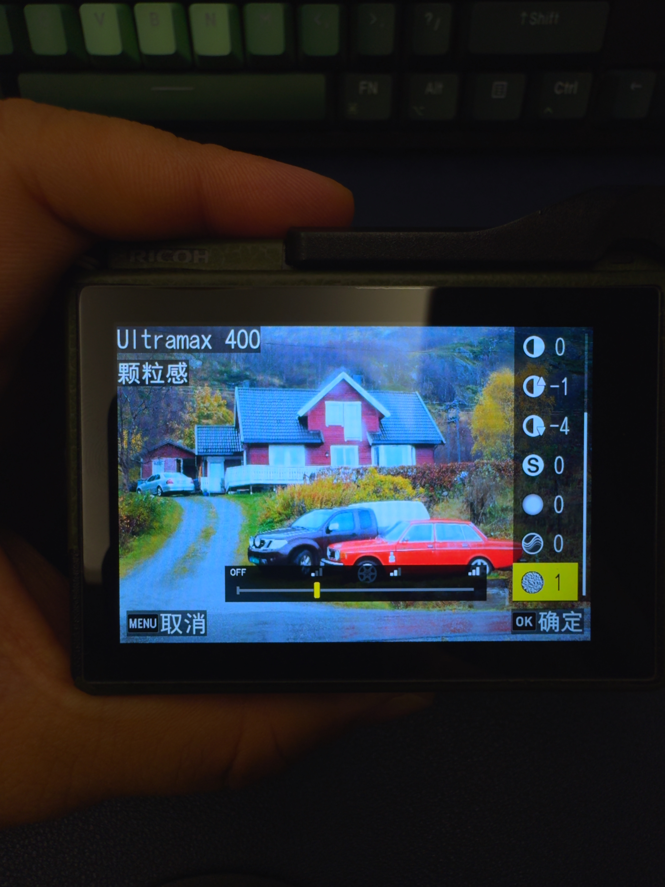
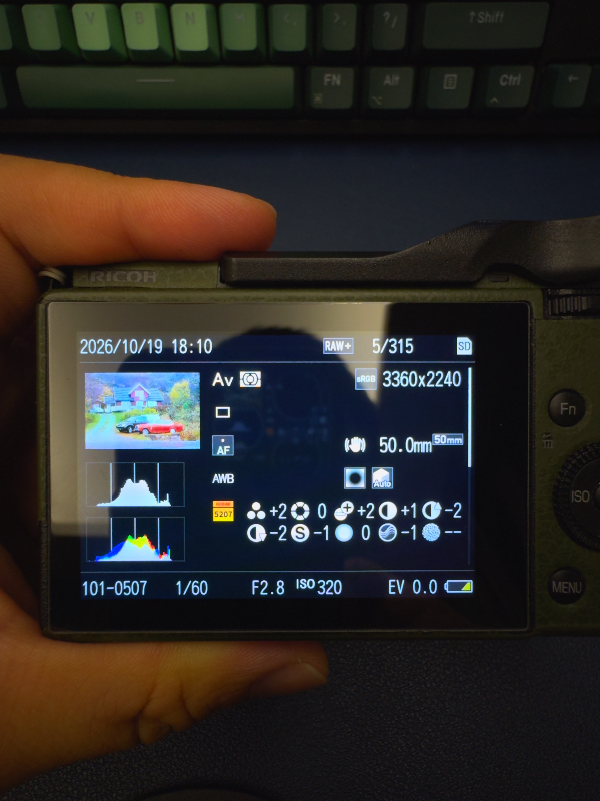
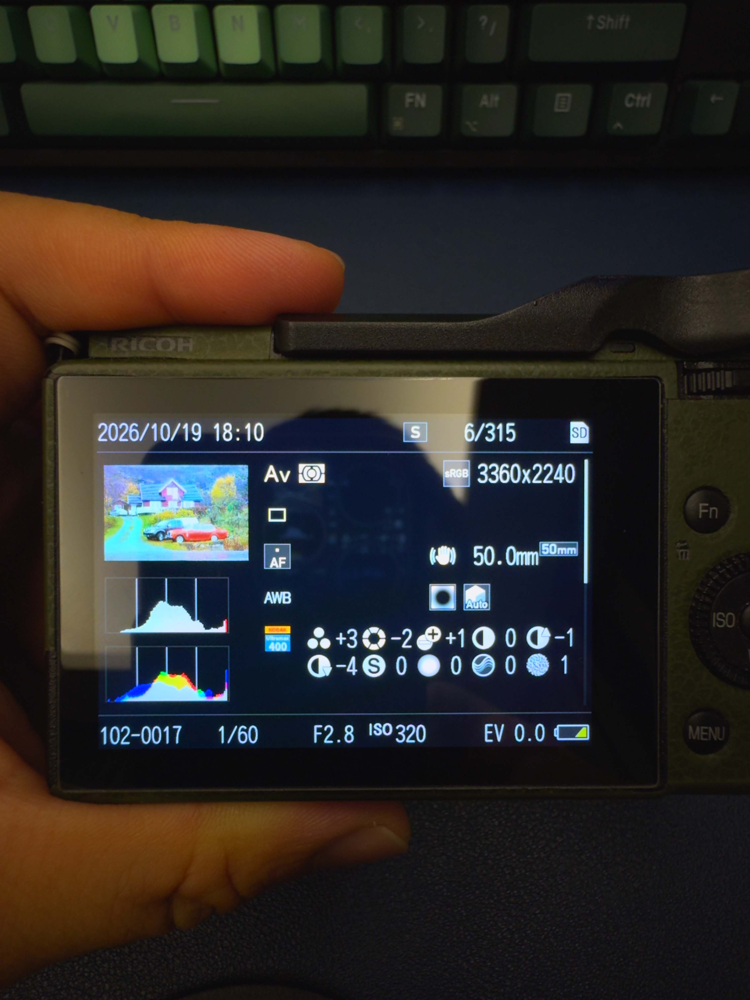
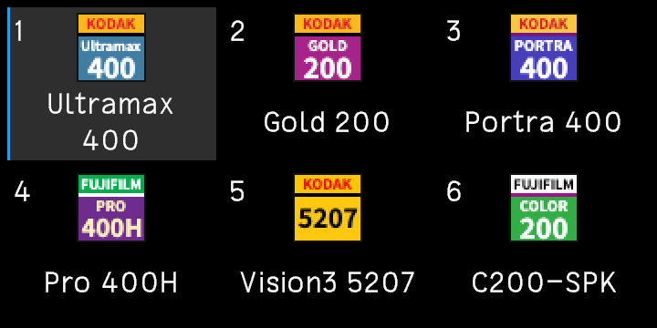
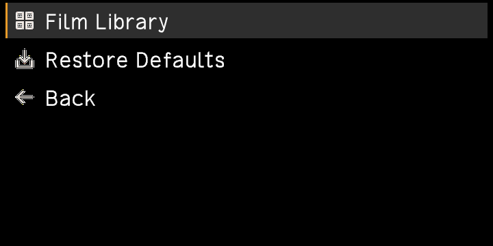

# GRSlot

GRSlot 为理光 GR III 新增六个独立影像控制槽位。这个版本能在 Mac 上用原厂 2.10 和随附预设生成固件候选。候选通过电脑检查后仍待实机与发布验收，请先保留文件用于验证。

## 第一次使用

先用仓库随附的开源预设跑通构建，再尝试导入自己的预设。首次无需手动选片，构建器会用 Studio Lite 保存一份默认项目。

1. 把 GitHub 下载的 GRSlot 文件夹在 WorkBuddy 或其他能操作本机文件和终端的 Agent 里打开。
2. 找到标准 **GR III 原厂 2.10** 的 `fwdc239b.bin`，把文件路径告诉 Agent。机型和版本请在相机上确认。
3. 发下面这段提示。构建成功时，Agent 应给出 `fwdc239b.candidate.bin` 和 `verification.json` 的路径。

> 请帮我把 GRSlot 装到固件里。请读取仓库的 README.md 和 AGENTS.md。我第一次用，请直接用仓库随附的开源预设。原厂 GR III 2.10 固件在［把文件路径贴在这里］。请在本机生成固件候选，把文件和检查回执的路径发给我。

离线构建依赖 macOS、Python 3.9+、Apple Command Line Tools，以及当前 Python 环境里的 Unicorn 2.1.4。Agent 可以先查有没有装好。如果只有 Unicorn 缺失，可以在仓库目录建立一个单独的 Python 环境：

```bash
python3 -m venv .venv
.venv/bin/python -m pip install unicorn==2.1.4
```

如果 WorkBuddy 提示默认 Python 找不到 Unicorn，把已安装 Unicorn 的 Python 路径发给它，让它用该解释器继续运行。WorkBuddy 实跑使用的是 Python 3.12.13 和 Unicorn 2.1.4。

也可以在仓库目录手动构建。用刚创建的环境时，把下面的 `python3` 换成 `.venv/bin/python`：

```bash
python3 -B studio-lite/build_firmware.py --bundled \
  --firmware "/你的路径/fwdc239b.bin" --output "$HOME/Desktop/GRSlot-首次构建"
```

首次成功后，双击 `studio-lite/启动 Studio.command`，在 Studio Lite 里用随附胶片调整六槽并保存项目。构建时把 `--bundled` 换成 `--project "已保存项目的路径"`。自定义预设和图文覆盖目前可在 Studio Lite 准备和校验，离线构建入口支持随附胶片和六槽分配。

每次构建在仓库外选一个新输出目录。里面有固件候选、SHA-256 校验值、Studio 项目和检查回执。`PASS_DESKTOP_ARM_CONTAINER` 表示候选通过电脑检查，`BLOCKED_PENDING_RELEASE_VALIDATION` 表示它还未获准用于升级相机。

公开候选的回放记录 Golden 槽位和颗粒。重新给槽位分配胶片后，旧照片的槽位图标会按当前分配显示。

## 实机版的功能

这六个 **Golden 槽位**独立于机内原生槽位，每槽都能自定义胶片，使用原生影像控制的九项参数，并添加原厂颗粒（Grain）。

导入的胶片预设可用于拍摄时的实时成像，也能在机内处理 RAW 时重新选用。Golden 槽位里的彩色预设也能使用原机黑白滤镜的「颗粒感」（Grain）。回放照片时，按 DISP 切到详细信息页，可以查看拍摄或机内 RAW 处理所用的胶片预设，以及影像控制参数和颗粒设置。

你可以在 DARKSLIDE GR 里拟合自己的 LUT，把它作为 Golden 槽位的胶片，再用机内原生参数微调，做出自己想要的相机直出（SOOC）效果。

[简体中文使用说明](docs/guide.md) · [English user guide](docs/guide.en.md) · [51 款胶片清单](assets/library.json) · [Agent 工作流程](SKILL.md)

## 作者实机展示

| 新增影像控制槽位 | 机内 RAW 处理 | 彩色预设的原厂颗粒 |
| --- | --- | --- |
|  |  |  |
| 001 · 在机身「影像控制」中选择 GRSlot 新增的槽位。 | 002 · 在机内处理 RAW 时，也能选择 GRSlot 槽位里的胶片预设。 | 003 · 彩色预设也能使用原厂「颗粒感」，图中设为 1 档。 |

| DISP 回放 · 拍摄时使用的预设 | DISP 回放 · 机内后期使用的预设 |
| --- | --- |
|  |  |
| 004 · 回放详细信息显示拍摄时使用的 Vision3 5207。 | 005 · 回放机内 RAW 处理后的照片，详细信息显示所用的 Ultramax 400，颗粒为 1 档。 |



*FilmInfo 20261118 实机确认版的离线渲染。图中六槽为示例。*

## 在相机上是什么样

菜单总览里的 83 款是实机参考版的胶片数量。

[简体中文总览 · 12 页](docs/images/menu-overview-zh-cn.png) · [English overview · 12 pages](docs/images/menu-overview-en.png)

| 胶片库入口 | 胶片操作 | 胶片资料 |
| --- | --- | --- |
|  |  |  |

<details>
<summary>展开看 Portra 800 的六个版本</summary>


</details>

### 胶片图标


*与上方六槽使用同一套图标。40×40 原像素等比放大三倍。*

这些图标可以在 **Studio Lite** 里自定义。打开胶片资料，点「更换图标」导入自己的图片，或点「自定义图标」修改文字、配色、分隔线和色条。编辑器会以 40×40 像素预览，文字和长度以界面提示为准。

## 从 Studio Lite 开始


1. 在 macOS 上准备 Python 3.9 或以上，双击 `studio-lite/启动 Studio.command`，或在仓库根目录运行 `python3 -B studio-lite/app.py --port 0`。这条命令会自动选择空闲端口。浏览器未自动打开时，打开终端中显示的网址。
2. 在中间的胶片列表勾选要用的胶片，在右侧设置六槽的默认胶片。同一款可以放多个槽。点击右上角「保存项目」。
3. 如果需要校验，点「复制路径」，把项目 JSON 路径和自己取得的标准 GR III 原厂 2.10 固件路径交给能读到这些文件的本机 Agent。使用自定义库时，附上保存时对应的 `library.json`。校验通过后，交付的是配置和文件的校验结果。[使用说明](docs/guide.md) · [English user guide](docs/guide.en.md)

## 使用范围与免责声明

GRSlot 是独立社区项目，与理光无隶属或授权关系。原厂固件由使用者自行通过官方渠道取得。厂商名称和标识归各自权利人。使用或分享 LUT、图标和其他素材前，请确认相应授权。

### 固件版本限制

**GRSlot 的实机验证仅覆盖以官方 2.10 为底座的标准 GR III。** 评估上机兼容性时，请在机身上核对机型和当前固件版本，再单独校验电脑上的原厂更新文件。

- **机身已是官方 2.10**：这是当前唯一验证过的基底。文件校验通过只代表输入匹配。
- **机身是其他官方版本**：请勿直接叠加使用。高于 2.10 时停止，不要尝试降级。理光明确说明，安装 2.21 后无法退回旧版本。[理光 GR III 固件说明](https://www.ricoh-imaging.co.jp/english/support/digital/gr3_s.html)
- **机身使用第三方固件**：不要混刷或叠加。只有在该机身有适用且已确认可行的恢复流程时，才先恢复**官方 2.10**。无法确认能恢复到官方 2.10，就停止使用这套流程。

### 机型兼容性

**GR IIIx（GR3X）和 GR IV（GR4）均未在本项目中进行实机验证。** 想研究移植的用户，可以让本机 Agent 读取本仓库和自己取得的对应机型原厂固件，先做只读的兼容性分析。每款机型都需独立适配并验证，当前 GR III 的工具不能直接用于生成这些机型的固件。

仓库的本机构建器仅接受标准 GR III 原厂 2.10。其他机型的研究和适配需要各自的机身验证。

### 风险与免责声明

**请勿将本仓库的方法、配置或产物叠加到其他第三方固件上。** 不同固件的改动可能冲突，导致异常、数据丢失、无法开机或永久变砖，也可能影响保修。自行进行固件实验前，请备份照片和设置，并核对适用的官方恢复条件和使用条款。

仓库里的菜单图来自已实测的特定版本。Agent 校验通过只说明文件、配置和胶片数据符合当前检查规则。每份新生成的固件都需要独立验证，已有实机记录不能沿用到新的机型、版本或胶片组合。反馈问题时，请提供机型、版本、文件 SHA-256 和复现步骤，勿上传原厂或修改版固件。

本项目按现状提供。在适用法律允许的范围内，作者不对使用、混刷或自行刷机造成的损失承担责任，且不提供刷回原厂、救砖或维修服务。依法不得排除或限制的责任仍适用。[使用前提与风险](references/usage-and-risk.md) · [许可证](LICENSE)

## 致谢

- 感谢 **Andrea Volpato** 开源 Spektrafilm，随附 16 款相机拟合预设的数据适用 CC BY-SA 4.0。[Spektrafilm](https://github.com/andreavolpato/spektrafilm)
- 感谢 **Jan Lohse** 开源 Spectral Film LUT，35 款拟合预设的源项目采用 MIT，输入经 Alcedo 导出和色彩空间转换。具体来源及待核对的导出包版本见 [派生记录](CHANGELOG.txt)。[Spectral Film LUT](https://github.com/JanLohse/spectral_film_lut)
- 感谢 **zidage 和 Alcedo Studio 贡献者**。Alcedo Studio 的胶片库包含 Spectral Film LUT 和 Spektrafilm，本仓库的 35 款 Spectral 拟合预设以 Alcedo 导出的 CUBE 为中间输入。[Alcedo Studio](https://github.com/zidage/AlcedoStudio)
- 感谢 **LiorMoment** 创建 DARKSLIDE GR 并提供 LUT 拟合能力，也感谢 **Ady0402** 和桌面版贡献者。[DARKSLIDE GR](https://github.com/LiorMoment/darkslide-gr) · [LiorMoment](https://github.com/LiorMoment) · [Ady0402](https://github.com/Ady0402)

程序与 skill 文档按 **GPL-2.0-only** 提供。第三方数据、字体和其他材料保留各自的许可。逐款署名及文件指纹记录在胶片清单。[来源说明](SOURCES.md) · [第三方声明](THIRD_PARTY_NOTICES.md) · [胶片清单](assets/library.json)

## 作者

- 小红书主页名称：Vincent郑大钱🌊
- 小红书号：493659547
