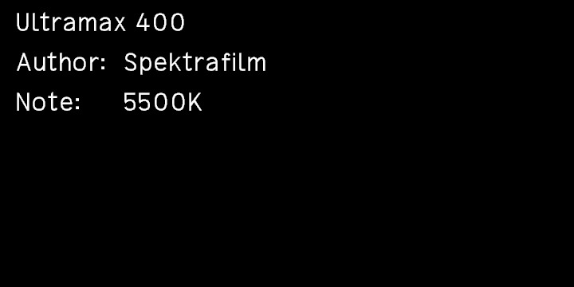
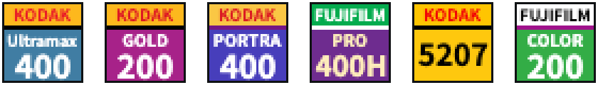
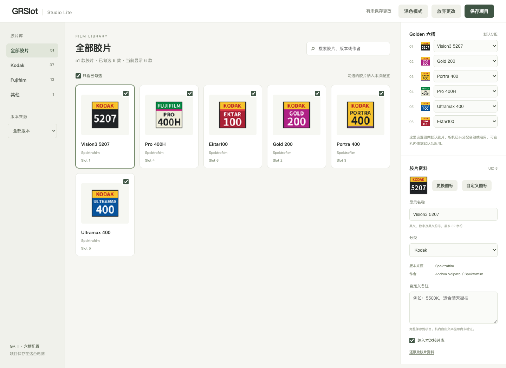

# GRSlot

为 Ricoh GR III 选胶片，配置独立于机内原生预设的 **Golden 影像控制六槽**。六槽可自定义，并保留原生影像控制的九项参数与 Grain（颗粒）。用本机浏览器里的 **Studio Lite** 从 51 款随附预设中选片、改图标、写备注，把保存的 JSON 交给 AI Agent 校验。自定义 LUT 可先在 DARKSLIDE GR 中拟合。

[简体中文使用说明](docs/guide.md) · [English user guide](docs/guide.en.md) · [51 款胶片清单](assets/library.json) · [Agent 工作流程](SKILL.md)

## 在相机上是什么样

[简体中文总览 · 12 页](docs/images/menu-overview-zh-cn.png) · [English overview · 12 pages](docs/images/menu-overview-en.png)

总览显示 FilmInfo 实机确认版的 83 款分类计数。本仓库随附 51 款预设。

*FilmInfo 20261118 实机确认版的菜单离线渲染。六槽使用公开胶片做示例，具体分配由用户配置。*

| 胶片库入口 | 胶片操作 | 胶片资料 |
| --- | --- | --- |
|  |  |  |

展开看 Portra 800 的六个版本

### 胶片图标

*与上方六槽使用同一套图标。40×40 原像素等比放大三倍。*

这些图标可以在 **Studio Lite** 里自定义。打开胶片资料，点「更换图标」导入自己的图片，或点「自定义图标」修改文字、配色、分隔线和色条。编辑器会以 40×40 像素预览，文字和长度以界面提示为准。

## 从 Studio Lite 开始

1. 在 macOS 上双击 `studio-lite/启动 Studio.command`，或在仓库根目录运行 `python3 -B studio-lite/app.py`。
2. 选片、排六槽、编辑资料，点击右上角**保存项目**。复制页面显示的 JSON 路径。

### **3. 把 JSON 路径和自己取得的标准 GR III 原厂 2.10 固件路径交给同一台电脑上的 Agent。使用自定义胶片库时，附上对应的本地 `library.json` 路径。**

**目前可完成 Studio 配置和 Agent 校验。** 通用固件构建尚未就绪，仓库交付胶片数据、验证工具和菜单参考源码。[使用说明](docs/guide.md) · [English user guide](docs/guide.en.md)

## 使用范围与免责声明

GRSlot 是独立社区项目，与理光无隶属或授权关系。原厂固件由使用者自行通过官方渠道取得。厂商名称和标识归各自权利人。使用或分享 LUT、图标和其他素材前，请确认相应授权。

### 固件版本限制

**GRSlot 的实机验证仅覆盖以官方 2.10 为底座的标准 GR III。** 首次安装前，机身必须正常运行官方 2.10。请在相机上核对机型和版本，并校验本机原厂更新文件。

- **机身已是官方 2.10**：这是当前唯一验证过的基底。文件校验通过只代表输入匹配。
- **机身是其他官方版本**：请勿直接叠加使用。高于 2.10 时停止，不要尝试降级。理光明确说明，安装 2.21 后无法退回旧版本。[理光 GR III 固件说明](https://www.ricoh-imaging.co.jp/english/support/digital/gr3_s.html)
- **机身使用第三方固件**：不要混刷或叠加。只有在该机身有适用且已确认可行的恢复流程时，才先恢复**官方 2.10**。无法确认能恢复到官方 2.10，就停止使用这套流程。

### 机型兼容性

**GR IIIx（GR3X）和 GR IV（GR4）均未在本项目中进行实机验证。** 想研究移植的用户，可以让本机 Agent 读取本仓库和自己取得的对应机型原厂固件，先做只读的兼容性分析。每款机型都需独立适配并验证，当前 GR III 的工具不能直接用于生成这些机型的固件。

本仓库提供方法、参考源码和可验证的准备流程。Agent 可以据此研究适配，是否能生成可用固件取决于目标机型的适配、构建与实机验证。如果你想用图形界面一键生成固件，请选用已明确支持你机型和版本的其他项目。

### 风险与免责声明

**请勿将本仓库的方法、配置或产物叠加到其他第三方固件上。** 不同固件的改动可能冲突，导致异常、数据丢失、无法开机或永久变砖，也可能影响保修。自行进行固件实验前，请备份照片和设置，并核对适用的官方恢复条件和使用条款。

本项目按现状提供。在适用法律允许的范围内，作者不对使用、混刷或自行刷机造成的损失承担责任，且不提供刷回原厂、救砖或维修服务。依法不得排除或限制的责任仍适用。[使用前提与风险](references/usage-and-risk.md) · [许可证](LICENSE)

## 致谢

- 感谢 **Andrea Volpato** 开源 Spektrafilm，随附 16 款相机拟合预设的数据适用 CC BY-SA 4.0。[Spektrafilm](https://github.com/andreavolpato/spektrafilm)
- 感谢 **Jan Lohse** 开源 Spectral Film LUT，35 款拟合预设的源项目采用 MIT，输入经 Alcedo 导出和色彩空间转换。具体来源及待核对的导出包版本见 [派生记录](CHANGELOG.txt)。[Spectral Film LUT](https://github.com/JanLohse/spectral_film_lut)
- 感谢 **zidage 和 Alcedo Studio 贡献者**。Alcedo Studio 的胶片库包含 Spectral Film LUT 和 Spektrafilm，本仓库的 35 款 Spectral 拟合预设以 Alcedo 导出的 CUBE 为中间输入。[Alcedo Studio](https://github.com/zidage/AlcedoStudio)
- 感谢 **LiorMoment** 创建 DARKSLIDE GR 并提供 LUT 拟合能力，也感谢 **Ady0402** 和桌面版贡献者。[DARKSLIDE GR](https://github.com/LiorMoment/darkslide-gr) · [LiorMoment](https://github.com/LiorMoment) · [Ady0402](https://github.com/Ady0402)

程序与 skill 文档按 **GPL-2.0-only** 提供。第三方数据、字体和其他材料保留各自的许可。逐款署名及文件指纹记录在胶片清单。[来源说明](SOURCES.md) · [第三方声明](THIRD_PARTY_NOTICES.md) · [胶片清单](assets/library.json)
