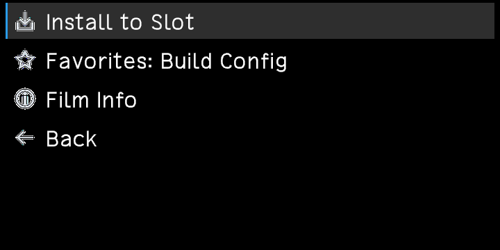
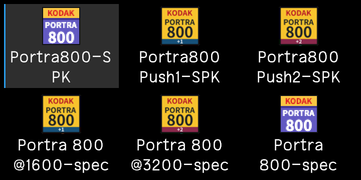

# GRSlot

为 Ricoh GR III 选胶片、配六槽。用 AI Agent 从 **51 款随附预设**中挑选，或导入你在 DARKSLIDE GR 中拟合的 LUT。

[使用说明](docs/guide.md) · [51 款胶片清单](assets/library.json) · [Agent 工作流程](SKILL.md)

## 在相机上是什么样

*FilmInfo 20261118 实机确认版的菜单离线渲染。六槽使用公开胶片做示例，具体分配由用户配置。*

| 胶片库入口 | 胶片操作 | 胶片资料 |
| --- | --- | --- |
|  |  |  |

展开看 Portra 800 的六个版本

### 胶片图标

*与上方六槽使用同一套图标。40×40 原像素等比放大三倍。*

## 交给 Agent

把仓库地址和本机的**标准 GR III 原厂 2.10** 文件路径交给 Agent，再告诉它选哪些胶片、六槽怎么排。例如：

> 请按 GRSlot 的 SKILL.md，校验我本机的原厂 2.10 文件。帮我选 Vision3 5207、Gold 200、Portra 400、Pro 400H、Ultramax 400 和 Ektar100，按顺序分配六槽，保存本地配置并给我验证回执。

**本仓库提供数据准备、验证工具和菜单参考源码。** 交付是胶片清单、参数和回执，无固件下载、生成或安装入口。[完整步骤和命令](docs/guide.md)

## 使用范围与免责声明

GRSlot 是独立社区项目，与理光无隶属或授权关系。原厂固件应由使用者通过官方渠道自行取得，厂商名称及标识归各自权利人。用户应确认自己有权使用或分享所提供的 LUT、图标和其他素材。

使用修改固件可能导致相机无法开机、设置或照片丢失、设备损坏，也可能影响保修。若自行开展仓库范围之外的实验，应先核对机型和版本、备份数据，并确认适用的官方恢复条件。文件校验通过只表示输入符合本工具的支持范围。

项目按现状提供。无担保及责任限制以随附许可证和适用法律为准，依法不得排除或限制的责任仍适用。[使用前提与风险](references/usage-and-risk.md) · [许可证](LICENSE)

## 致谢

- 感谢 **Andrea Volpato** 开源 Spektrafilm，随附 16 款相机拟合预设的数据适用 CC BY-SA 4.0。[Spektrafilm](https://github.com/andreavolpato/spektrafilm)
- 感谢 **Jan Lohse** 开源 Spectral Film LUT，35 款拟合预设的源项目采用 MIT，输入经 Alcedo 导出和色彩空间转换。具体来源及待核对的导出包版本见 [派生记录](CHANGELOG.txt)。[Spectral Film LUT](https://github.com/JanLohse/spectral_film_lut)
- 感谢 **zidage 和 Alcedo Studio 贡献者**。Alcedo Studio 的胶片库包含 Spectral Film LUT 和 Spektrafilm，本仓库的 35 款 Spectral 拟合预设以 Alcedo 导出的 CUBE 为中间输入。[Alcedo Studio](https://github.com/zidage/AlcedoStudio)
- 感谢 **LiorMoment** 创建 DARKSLIDE GR 并提供 LUT 拟合能力，也感谢 **Ady0402** 和桌面版贡献者。[DARKSLIDE GR](https://github.com/LiorMoment/darkslide-gr) · [LiorMoment](https://github.com/LiorMoment) · [Ady0402](https://github.com/Ady0402)

程序与 skill 文档按 **GPL-2.0-only** 提供。第三方数据、字体和其他材料保留各自的许可。逐款署名及文件指纹记录在胶片清单。[来源说明](SOURCES.md) · [第三方声明](THIRD_PARTY_NOTICES.md) · [胶片清单](assets/library.json)
