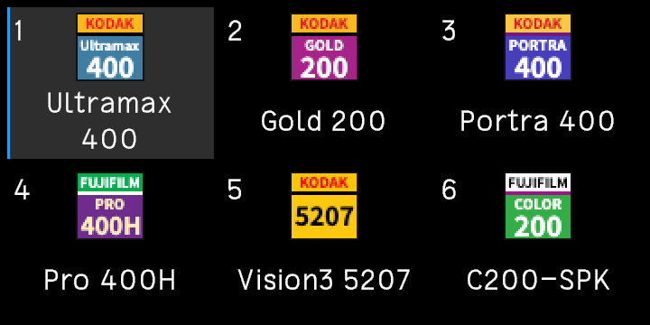
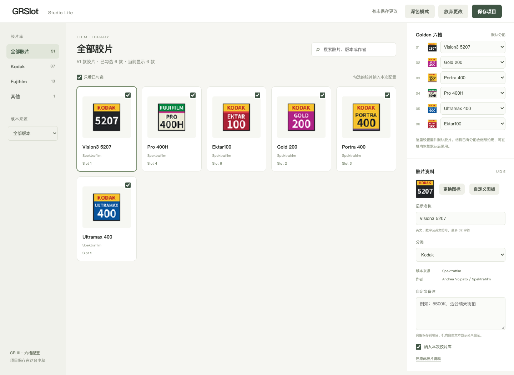
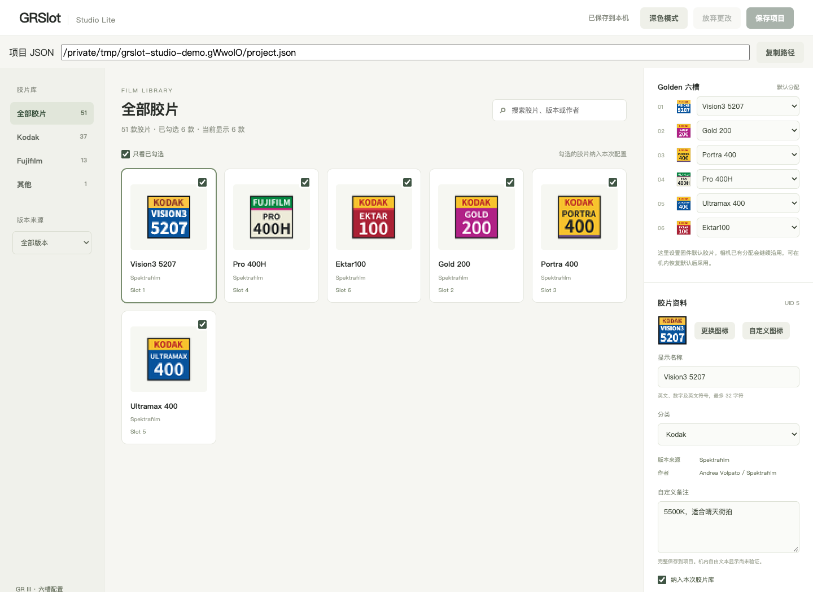

# GRSlot User Guide

[简体中文](guide.md) · English

GRSlot Studio Lite runs in your local browser. Pick from 51 included film presets, assign the six Golden Slots, edit film names, categories, icons and notes, then hand the saved project JSON to an agent running on the same computer.

**Build a local firmware candidate with the bundled open-source presets before importing your own.** For your first run, follow the [repository quick start](../README.md#第一次使用). The build writes `fwdc239b.bin` and a verification report. This guide covers editing, saving and validating a Studio Lite project. [Build status](../references/build-status.md)

## 1. See the camera menus and film icons



[English menu overview · 12 screens](images/menu-overview-en.png) · [Simplified Chinese menu overview · 12 screens](images/menu-overview-zh-cn.png)


These offline renders come from the camera-tested FilmInfo version. Its category screen shows **83 films**. This repository includes **51 presets**. The menu displays the film name and icon assigned to each slot.

## 2. Select films and assign the six slots

On macOS with Python 3.9 or newer, double-click `studio-lite/启动 Studio.command`, or run this from the repository root:

```bash
python3 -B studio-lite/app.py
```

Pick a category on the left, tick the films you want in the center, then assign Golden Slots 1 through 6 in the right pane. Each slot must use a selected film. You can reuse a film in more than one slot.



Open a film card to edit its details. Use **更换图标** (Replace icon) to import an image, or **自定义图标** (Customize icon) to edit the lettering and colors. Notes such as “5500K, good for street photography in sunlight” are saved in full in the local project. Freeform notes have yet to be validated for display on the camera.


The six assignments are **defaults**. A camera already running GRSlot may retain its saved assignments until you use the corresponding **Restore Defaults** option.

## 3. Save the project and hand it to the agent

Click **保存项目** (Save Project) in the top right. Studio shows the local `project.json` path. Use **复制路径** (Copy Path) to copy it. Reopening the page loads the saved revision. Save again after further edits.



Obtain the official **firmware 2.10 for the standard GR III** from Ricoh. Extract the archive and give your local agent the path to `fwdc239b.bin` or its containing folder. When assessing camera compatibility, check the model and version on the camera separately. Stop if the camera is on a version newer than 2.10. [Requirements and risks](../references/usage-and-risk.md)

Copy this prompt to your agent:

> Follow the GRSlot SKILL.md to validate my Studio Lite project. The project JSON is at [local path], and the original firmware 2.10 for my standard GR III is at [local path]. Show my selected films, six Golden Slot assignments, icons and notes, then report the validation results.

The agent can run this from the repository root:

```bash
python3 -B studio-lite/check_project.py \
  --project /absolute/project.json \
  --firmware /absolute/official-folder
```

The result lists `slots` in order from 1 to 6. The `selected` list includes film UIDs, display names, categories, notes and icon hashes. Use `project_sha256` to identify the checked JSON. `PASS_STUDIO_PROJECT_ONLY` means the project, film assets and official input passed the preparation checks.

## 4. Optional: use your own fitted LUT

On your first run, use the included open-source film presets to select films, assign the six slots, and save a project. If you want to run the full desktop validation, use that project first. Import your own presets once that workflow works on your computer.

Use the same official input to fit a LUT you have permission to use in DARKSLIDE GR. Ask your agent to import it into a local film library using the [Darkslide input contract](../references/darkslide-import.md).

```bash
python3 -B studio-lite/app.py --library /absolute/prepared-library/library.json
```

After saving, give the agent the same local film library along with the project JSON and official input. Add `--library /absolute/prepared-library/library.json` to the validation command. Studio checks the library fingerprint because a UID alone cannot restore a custom LUT's fitted parameters.
