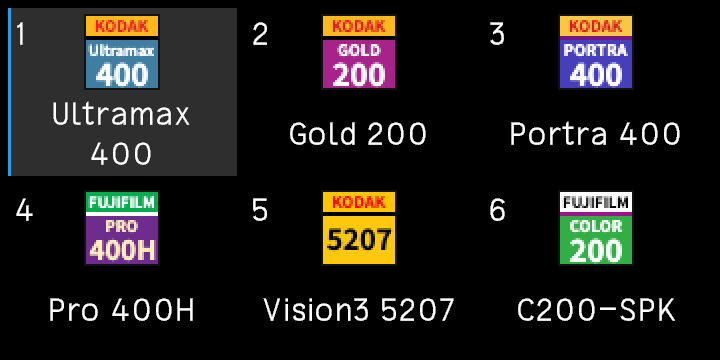
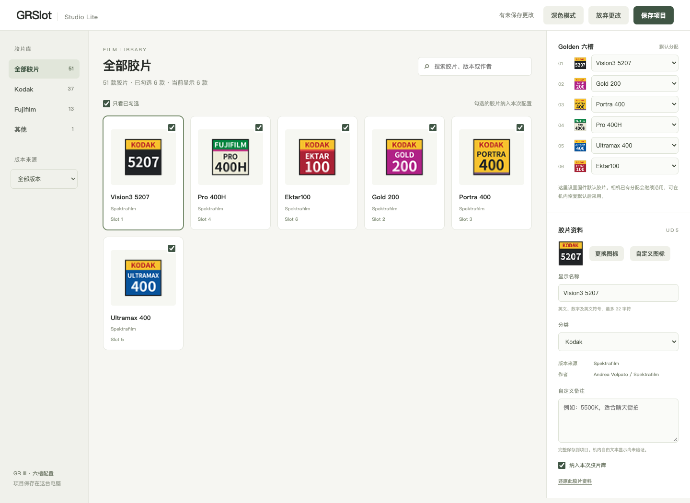
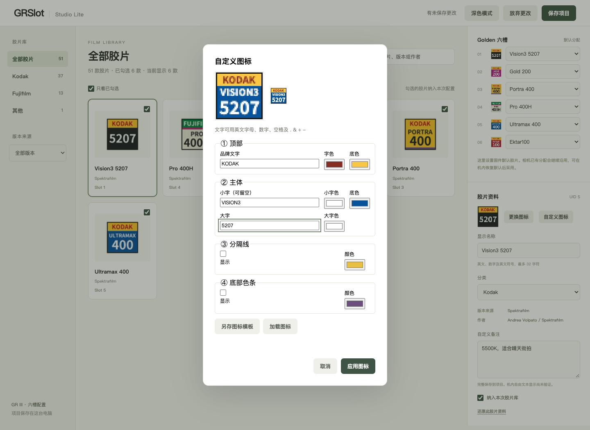
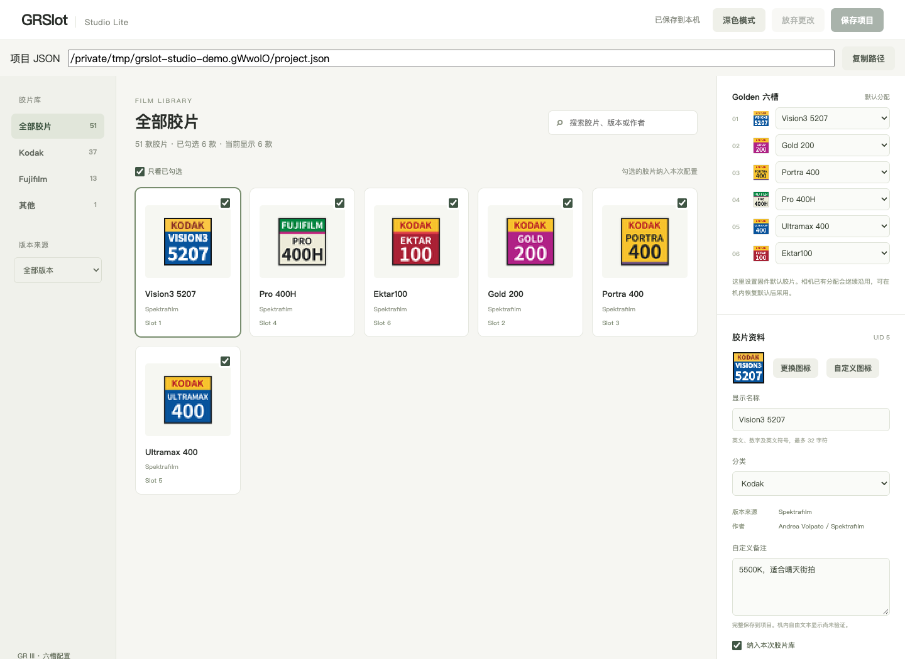

# GRSlot 使用说明

简体中文 · [English](guide.en.md)

GRSlot Studio Lite 在本机浏览器里管理胶片库和 Golden 六槽。你可以选用随附的 59 款预设，改名称、分类、图标和备注，然后把保存的项目 JSON 交给本机 Agent 校验。

**先用随附开源预设生成一次固件候选，再导入自己的预设。** 首次构建请参见[仓库首页](../README.md#第一次使用)。下文介绍 Studio Lite 的编辑、保存和独立校验。[当前构建状态](../references/build-status.md)

## 1. 看相机菜单和胶片图标



[简体中文菜单总览 · 12 页](images/menu-overview-zh-cn.png) · [英文菜单总览 · 12 页](images/menu-overview-en.png)


菜单图来自 FilmInfo 实机确认版的离线渲染，分类页上的 **83 款**是当时实机版的库。这个仓库随附 **59 款**。菜单里的六槽名称和图标会随槽位分配变化。

## 2. 在 Studio Lite 选片、配置六槽

在 macOS 上准备 Python 3.9 或以上。双击 `studio-lite/启动 Studio.command`，或在仓库根目录运行：

```bash
python3 -B studio-lite/app.py
```

页左选分类，中间勾选要用的胶片，右侧按顺序给 Golden 槽位 1 到 6 分配胶片。每个槽位须指向已勾选的胶片。同一款可以分给多个槽位。



点击胶片卡片打开「胶片资料」。用「更换图标」导入图片，或点「自定义图标」编辑文字与配色。备注例如「5500K，适合晴天街拍」，会完整保存在本地项目。机内自由文本显示仍待验证。



六槽设置定义的是**默认胶片**。已有 GRSlot 机身可能继续沿用之前保存的分配，只有执行对应的「恢复默认」才会采用新默认。

## 3. 保存项目，交给 Agent

点击右上角「保存项目」。页面显示本机 `project.json` 路径，点「复制路径」即可交给 Agent。重开页面会读回已保存版本。继续编辑后记得保存。



准备自己通过 Ricoh 官方渠道取得的**标准 GR III 原厂 2.10** 更新文件。解压后把 `fwdc239b.bin` 路径或它所在的文件夹路径交给能读取这些文件的本机 Agent。涉及机身时还要在相机上确认机型和当前版本，版本高于 2.10 时停止。[使用前提与风险](../references/usage-and-risk.md)

可以把下面这段交给 Agent：

> 请按 GRSlot 的 SKILL.md 校验我的 Studio Lite 项目。项目 JSON 在「本机路径」，标准 GR III 原厂 2.10 文件在「本机路径」。请列出勾选胶片、Golden 六槽、图标和备注，告诉我校验结果。

Agent 可以在仓库根目录运行：

```bash
python3 -B studio-lite/check_project.py \
  --project /absolute/project.json \
  --firmware /absolute/official-folder
```

结果里的 `slots` 按槽位 1 到 6 排列，`selected` 包含胶片 UID、显示名、分类、备注和图标摘要。比对 `project_sha256` 可确认这次检查的是哪一份 JSON。`PASS_STUDIO_PROJECT_ONLY` 代表配置、资产与原厂输入检查通过。

## 4. 可选：使用自己拟合的 LUT

第一次请先用随仓库附带的开源胶片预设跑通选片、六槽分配和保存。需要完整桌面校验时，也先用这份项目校验，再回来导入自己的预设。

先用相同的原厂输入在 DARKSLIDE GR 拟合有权使用的 LUT，再让 Agent 按 [Darkslide 输入契约](../references/darkslide-import.md) 导入一个本地胶片库。

```bash
python3 -B studio-lite/app.py --library /absolute/prepared-library/library.json
```

保存后，除了 JSON 和原厂文件路径，还要让 Agent 使用同一份本地胶片库，校验命令加 `--library /absolute/prepared-library/library.json`。Studio 项目会校验库指纹，UID 本身无法还原自定义 LUT 的拟合参数。
